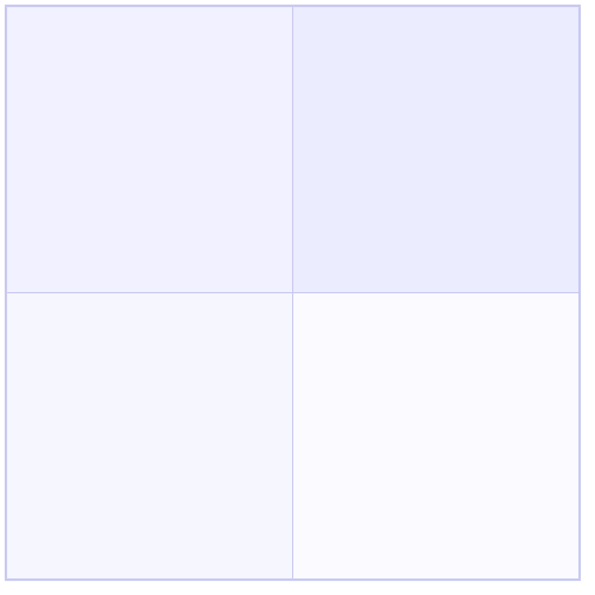

# <Thesis>: research findings

Run: `runs/<slug>/` · Date: <date> · Scope: see `scope.md`
Evidence base: <n> sources across tiers <list> · Gaps: <n> open

---

## Verdict

<Two or three sentences. The answer to the question in scope.md.>

**On the null hypothesis** — <what was found bearing on what would make this a bad idea>.

**Confidence:** <High / Medium / Low>, because <what drives it>.

## What would change this

- <Specific, checkable condition>
- <Specific, checkable condition>

---

## 1. Consumption

Is anyone spending on this today, and on what instead.

<Prose with evidence IDs.>

```mermaid
flowchart LR
  %% where money flows today and who intercepts it
```

## 2. Competition

<Prose. Include the status quo and the internal-build option.>



| Competitor | Sells to | Pricing | Wedge | Trend | Evidence |
|---|---|---|---|---|---|

## 3. Segment and fit

<Prose. Beachhead recommendation with the reasoning for choosing it over runners-up.>

```mermaid
sequenceDiagram
  %% how a purchase actually gets made, and by whom
```

## 4. Investor pairing

<Prose. Ranked shortlist with the objection each is most likely to raise.>

```mermaid
graph LR
  %% investor - company - thesis relationships
```

---

## The case against

<The strongest good-faith argument that this is a bad idea, assembled from the evidence.>

## What could not be established

| Question | Why it did not resolve | What would answer it |
|---|---|---|

## Evidence index

<n> sources in `evidence/`. Tier distribution: T0 <n>, T1 <n>, T2 <n>, T3 <n>, T4 <n>.
Contested claims: <IDs>.
